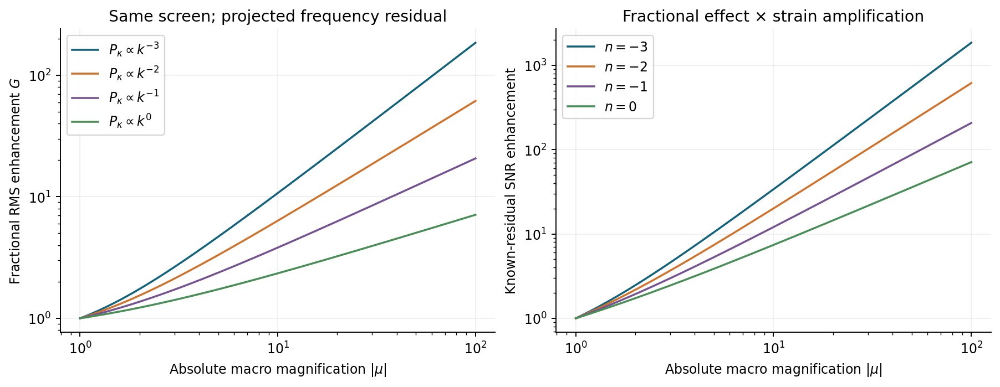
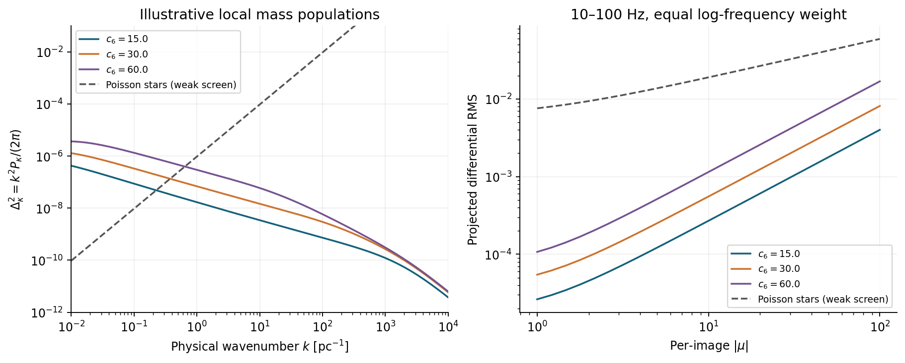

# Diffraction in strongly lensed gravitational-wave image pairs

A reproducible first calculation of the idea that a **strongly lensed, high-redshift black-hole merger** could reveal weak diffraction by small dark-matter structures. The implementation includes the local macro-lens response, frequency-dependent residuals, unequal-image noise, stochastic covariance inference, and a stellar-foreground comparison.

**Status:** an analytic and numerical exploration with explicit physical assumptions. It is **not** a calibrated CDM forecast, a predicted event rate, or a sensitivity claim for an unspecified fourth-generation detector.

Start with [the calculation note](docs/report.pdf) ([LaTeX](docs/report.tex)), then [the numerical results](results/summary.json) and [the literature audit](docs/literature_audit.md).

## What the calculation finds

Strong lensing can help in two separate ways: it increases the observed strain by `sqrt(|mu|)`, and it changes the response to density fluctuations close to the macroimage. For a scale-free convergence spectrum `P_kappa(k) ∝ k^-2`, the **fractional, projected** RMS grows approximately as `0.612 |mu|` for the local fold-like configuration used here. A known residual's SNR can then grow approximately as `|mu|^(3/2)` at fixed source and screen population.

That enhancement is conditional on the spectrum, the same-plane approximation, and weak perturbations. It should not be applied uniformly to all cosmological line-of-sight halos. The macroimage kernel and the repeated-image idea have direct prior art in [Oguri & Takahashi (2022)](https://arxiv.org/abs/2204.00814); this repository implements and checks that framework.



### An explicit ground-band benchmark

We calculate a local population of finite NFW halos at `z_l=0.5` in front of a source at `z_s=2`, with `kappa_sub=0.005`, `dN/dM ∝ M^-1.9` over `10^-6–10^8 Msun`, and a documented concentration law. The reference calculation uses equal weight per logarithmic frequency over **10–100 Hz**. Two independent image perturbations have opposite parity and equal absolute magnification.

For an **unlensed in-band SNR of 50**, the default concentration model gives:

| Per-image magnification | Observed SNR per image | Differential subhalo RMS | Known-realization residual SNR ceiling | Subhalo-only Gaussian separation | Separation with default stellar foreground |
|---:|---:|---:|---:|---:|---:|
| 10 | 158 | 0.0555% | 0.0621 | 0.00183 | 0.000753 |
| 30 | 274 | 0.199% | 0.386 | 0.0689 | 0.00728 |
| 100 | 500 | 0.814% | 2.88 | 2.05 | 0.0540 |

The “Gaussian separation” is `sqrt(2 D_KL)`, **not a calibrated Gaussian discovery significance**. An unknown stochastic lens realization is harder to identify than a specified residual template. The stellar benchmark uses `kappa_star=0.025` and effective stellar mass `0.5 Msun`; its differential RMS is about 3.3% at magnification 30 and 5.9% at magnification 100. The main foreground calculation integrates over the random stellar realization while fixing its covariance. The outputs also explore smaller stellar surface density and one unknown stellar covariance amplitude.



**Interpretation:** the enhanced fractional signal is real within the model, but a detectable diffraction signal is not automatically a dark-matter measurement. Low stellar surface density, lower-frequency sensitivity, subhalo survival and compactness, and the validity of the weak-screen approximation matter. Near magnification 100 the stellar Born approximation is already marginal in the reference band; these are diagnostic benchmarks rather than nonlinear microlensing forecasts.

### A correction to the initial frequency-scaling estimate

The original conversation's estimate of roughly equal CDM diffraction in LISA and at 100 Hz used an incorrect figure read-off and a shortcut for the unprojected variance. The raw response tends to constant geometric magnification at low wavenumber and is not necessarily localized at the Fresnel scale.

The version-1 [Choi et al. paper](https://arxiv.org/abs/2607.11887) actually plots a high-wavenumber slope approximately `P_kappa ∝ k^-2.71`. A vector digitization of its Figure 2 is recorded in [the provenance file](results/paper_figure2_provenance.json) and [sampled curve](results/paper_figure2_digitization.csv). For a power law, fixed geometry, and identically scaled frequency weighting, the projected RMS scales as `f^((n+2)/4)`. This gives a **conditional ratio near 0.2** between 100 Hz and 0.01 Hz: about five times smaller, rather than equal. It is not a complete comparison of two detector populations or an absolute normalization of this repository's local screen.

## Observable and inference conventions

The local macro Jacobian has eigenvalues `lambda_1,lambda_2`, and absolute magnification `1/abs(lambda_1 lambda_2)`. They are **inverse directional magnifications**. Wavenumber `q` in the numerical kernel is dimensionless: `q=k_phys*r_F(100 Hz)`.

The real projection removes exactly three nuisance directions:

- real constant amplitude;
- imaginary constant phase;
- imaginary linear-frequency arrival time.

It does not remove a real amplitude slope. The covariance is constructed for `[Re(delta F at all frequencies), Im(delta F at all frequencies)]`, retaining the noncircular complex statistics.

For matching spectral weights, the effective SNR of an image difference is

`rho_eff = rho_1*rho_2 / sqrt(rho_1^2 + rho_2^2)`.

For different frequency weight shapes, the pointwise harmonic weight must be integrated. Source cancellation requires a consistent detector-network/polarization model; raw detector strain ratios at different arrival times need not cancel the source.

The known-realization sensitivity is `rho_eff*epsilon_diff`. For an unknown Gaussian lens realization, the code instead diagonalizes the noise-whitened covariance and evaluates `sqrt(sum(eta-log(1+eta)))`. Independent equal weak events improve the RMS-amplitude threshold as `N^-1/4` under this stochastic model.

## Detector checks and image-dependent phase

The note also works through diagnostics for the repeated-image experiment:

- A frequency-dependent multiplicative calibration error **stable between image arrival times** cancels in a properly response-corrected image ratio.
- A detector-specific calibration change can be tested by comparing the image residual between detectors. The code includes a division-free image/detector cross-difference and a two-polarization network null projector.
- A frequency-dependent change common to all detectors at one image epoch remains exactly degenerate with a changed lens transfer. There is no universal systematics veto from image differencing alone.
- The same lens kernel constrains amplitude and phase jointly. In particular, an **unprojected ensemble** relation connects their variances at `f` to the amplitude variance at `2f`. A new test verifies its modewise origin. The relation must not be imposed directly on one fitted, finite-band residual; the theory must undergo the same projection and weighting as the data.

The geometric-optics Morse factors, at positive frequency, are **+1 for a minimum, -i for a saddle, and -1 for a maximum**. A saddle is a Hilbert transform of the real waveform, not simply a sign flip. The inverse Morse operator must be applied before differencing. Negative image parity is not the same as a negative strain amplitude; parity correction also transforms multiplicative calibration errors with the source and does not automatically cancel calibration drift.

## Reproduce

Python 3.10 or later, NumPy, SciPy, and Matplotlib are sufficient for the calculations. A LaTeX installation with `latexmk` is needed only to rebuild the note.

```bash
python -m venv .venv
source .venv/bin/activate
python -m pip install -r requirements.txt
python -m unittest discover -s tests -v
OPENBLAS_NUM_THREADS=1 python scripts/run_calculations.py
python scripts/plot_diagnostics.py
make note
```

The main script regenerates the figures, summary JSON, CSV table, and LaTeX table. It uses a fixed seed only for the illustrative random realizations; covariance integrals are deterministic. SNRs are inputs rather than values inferred from a detector design curve.

The independent numerical convergence check is:

```bash
OPENBLAS_NUM_THREADS=1 python tests/check_convergence.py
```

Its committed output is [results/convergence.json](results/convergence.json). Doubling radial, angular, and frequency sampling changes the principal subhalo RMS results by about **0.021%** and the reported foreground-conditioned information by less than **0.1%**. The covariance trace agrees with a separately accumulated scalar variance to floating-point precision.

The optional figure-digitization audit requires PyMuPDF:

```bash
python -m pip install PyMuPDF
python scripts/digitize_paper_figure2.py
# Alternatively, use a previously downloaded version-1 PDF:
python scripts/digitize_paper_figure2.py --source-pdf /path/to/2607.11887v1.pdf
```

That script version-locks the PDF by hash, fits all three plotted axes to their ticks, and checks adjacent curve segments. It uses a temporary download and does not redistribute the paper PDF. The curve is a digitized plotted vector path, not the authors' original data.

## Repository map

| Path | Contents |
|---|---|
| `gw_diffraction/waveoptics.py` | Macroimage kernel, real nuisance projection, covariance, power-law gain |
| `gw_diffraction/physical.py` | Physical geometry, finite NFW profiles, surface populations, stellar shot spectrum |
| `gw_diffraction/inference.py` | Image weights, covariance likelihood, information and sensitivity calculations |
| `gw_diffraction/diagnostics.py` | Exact Morse alignment, image/detector cross-difference, network null projector |
| `scripts/run_calculations.py` | Reproducible figures and numerical tables |
| `scripts/digitize_paper_figure2.py` | Optional, version-locked source-figure audit |
| `tests/` | Analytic, unit, normalization, and integration checks |
| `docs/` | LaTeX/PDF note, references, and literature audit |
| `figures/` | PNG previews and vector PDF figures |
| `results/` | Numerical data, explicit assumptions, and convergence/provenance records |

## Scope of a next physical forecast

A calibrated forecast needs redshifted inspiral–merger–ringdown waveforms and a specified detector network; a lens population and two-image selection; tidal subhalo survival; nonlinear stellar diffraction where needed; multi-plane propagation and inter-image correlations; and a network likelihood with calibration and population uncertainties. The current implementation makes these missing inputs explicit rather than assigning them implicit optimistic values.
